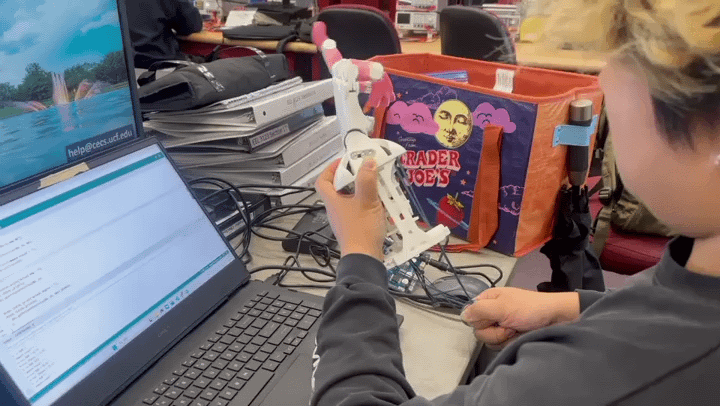

### November 3, 2026 — Embedded Programming Progress: AX-18A Motor Control

**Status: Initial embedded motor-control programs developed; actuator communication and position-control testing in progress.**

I began developing and organizing embedded test programs for the planned Dynamixel AX-18A conversion. The current experiments use an **OpenCR controller**, the **Dynamixel2Arduino** library, and **DYNAMIXEL Protocol 1.0**, which is required by the AX-18A.

My work includes:

- Setting up communication between the PC, OpenCR, and AX-18A through the appropriate serial interfaces.
- Configuring motor communication at **1 Mbps**, including motor detection using `ping()`.
- Developing test utilities for motor ID and baud-rate configuration.
- Testing torque enable/disable and position-control commands.
- Adding a wrist-motion test program that repeatedly commands a single actuator between two target positions (**RAW 380** and **RAW 40**) with a **500 ms** pause after each command.
- Using serial debug messages to inspect setup results and command transmission.

#### Embedded Control Demonstration

The following GIF documents a hands-on demonstration associated with the current robotic-hand control work. It provides a visual progress record; it is not a quantitative validation of accuracy, load capacity, or full-hand integration.

#### Current Test Code

- `current_Motor_test_codes/wrist_loop_back_forward/wrist_loop_back_forward.ino` — repeated position-command test for a single AX-18A actuator.
- Additional motor test sketches in `current_Motor_test_codes/` — communication and configuration experiments, including ID and baud-rate changes.

**Next steps:** Verify repeatability and actual position feedback under motion, establish safe motion limits, and integrate the tested control approach with the redesigned hand hardware. The current tests do **not** establish that all AX-18A actuators have been mechanically installed or that the full hand is under coordinated motor control.
